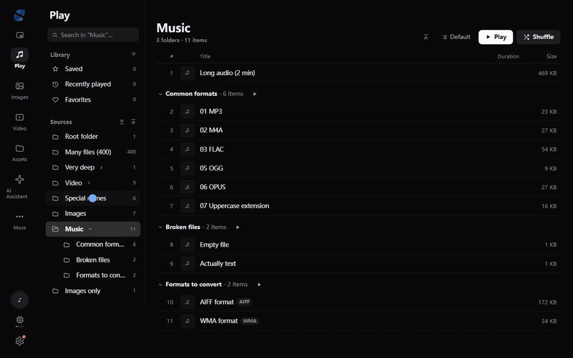
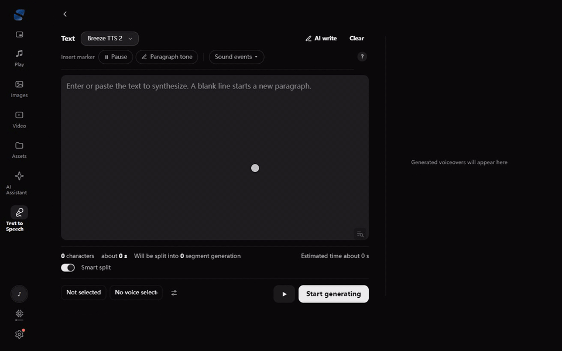
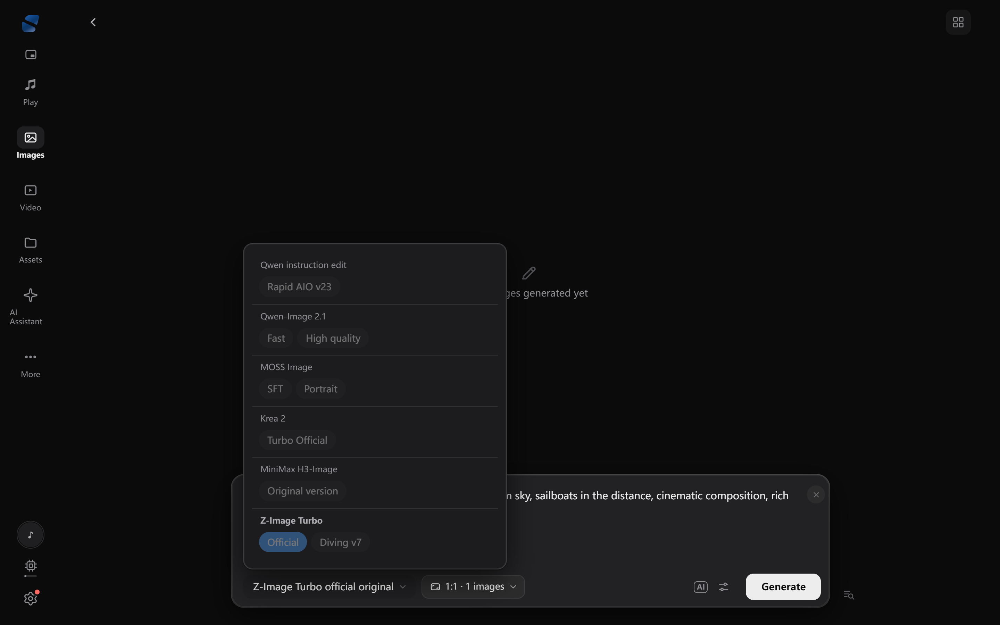
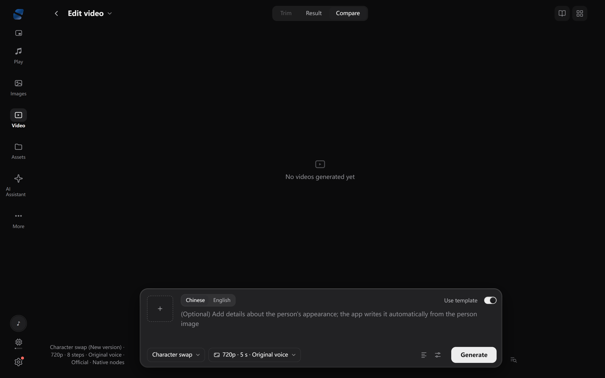
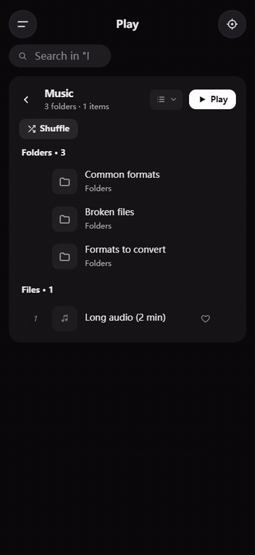
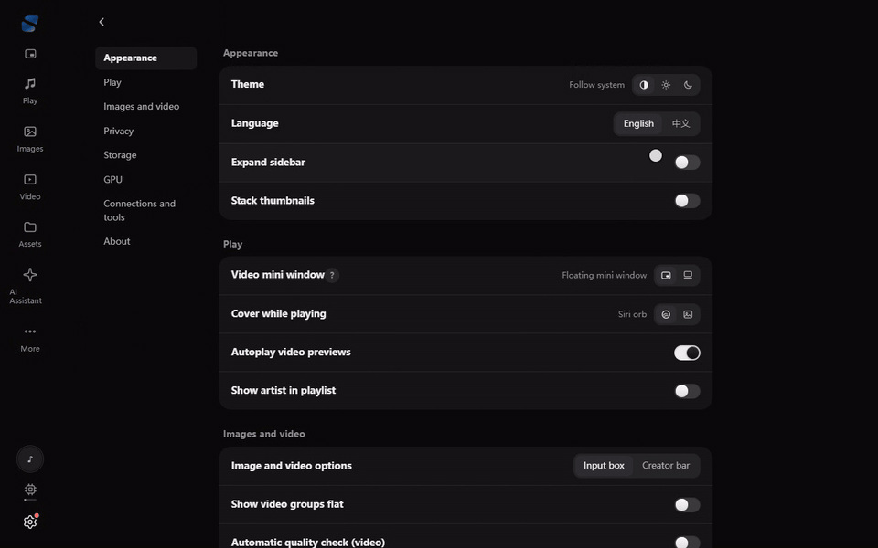
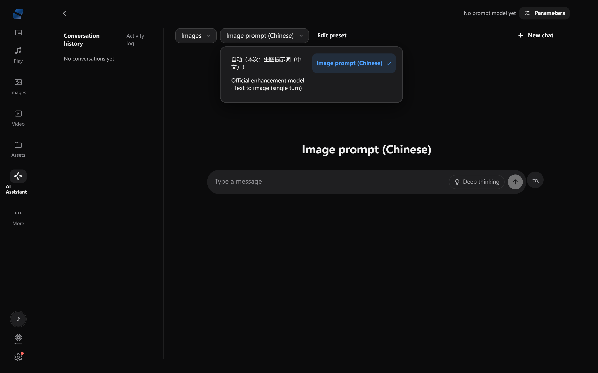
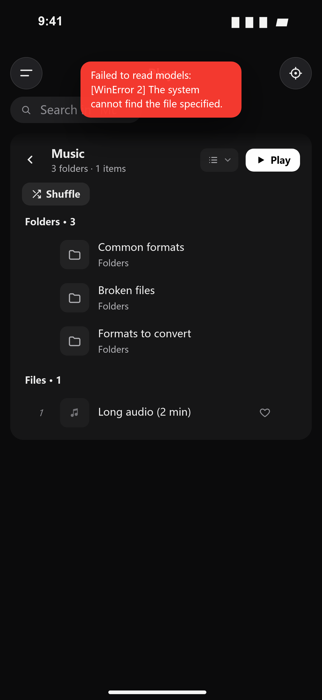

<h1 align="center">Studio</h1>

<p align="center"><b>A local, self-hosted creative workstation for speech, images and video.</b></p>

<p align="center">
  
  
  
  
</p>

<p align="center">
  
</p>

Studio brings text-to-speech, voice conversion, transcription, image generation, and video generation and editing together in one application. It also includes a media player and an asset library. Everything runs on a single Windows PC with an NVIDIA GPU. A Python backend coordinates several local inference engines on that one card. A dependency-free JavaScript frontend serves the same interface to a desktop window, a browser and a paired phone.

<table>
  <tr>
    <td align="center" width="25%"><b>Speech</b><br><sub>Text to speech · voice cloning · voice changer · transcription · recording edits</sub></td>
    <td align="center" width="25%"><b>Images</b><br><sub>Text to image · image to image · inpainting · instruction edits</sub></td>
    <td align="center" width="25%"><b>Video</b><br><sub>Generation · character and face swap · outfit change · motion transfer · batch</sub></td>
    <td align="center" width="25%"><b>Everywhere</b><br><sub>Desktop app · browser · iPhone web app · MCP agent interface</sub></td>
  </tr>
</table>

---

## Speech



- **Text to speech.** Paste or write a script and choose a voice. You can add direction per paragraph: emotion, delivery, pauses and sound events. Long scripts are split into segments automatically and rendered one by one. Any segment can be regenerated without redoing the rest, and the final merge is atomic.
- **Voices.** Design a voice from a text description, clone one from a short clip, or record one live. Model profiles cover Breeze TTS 2, IndexTTS-2.5 and Qwen3-TTS, and the audio engine ships specifications for more than a hundred other audio model families.
- **Voice changer.** Convert a recording to another voice (Seed-VC / RVC).
- **Transcription.** Qwen3-ASR or Faster-Whisper, with optional proofreading by an LLM. The LLM can be Anthropic Claude through the official API, any OpenAI-compatible endpoint, or a fully offline local model.
- **Recording edits.** Change, insert or remove words in a recording from a one-line instruction, keeping the speaker's voice and tone.
- **Subtitles and translation.** Time-synchronized lyrics and subtitles in the player. They can be translated with Google Translate or offline with a local translation model.

## Images



- **Generation and editing.** Text to image, image to image, inpainting and instruction-based editing with Qwen-Image 2.1, MOSS Image, Krea 2, MiniMax H3-Image and Z-Image Turbo. The models run in ComfyUI or stable-diffusion.cpp, and the workflows are assembled in code from the official templates.
- **Prompt help.** Prompts can be enhanced by the official prompt-enhancement models, or written by the local AI Assistant from the image and the request.
- **Editable settings.** Every model starts from its recommended settings. Steps, CFG, sampler, scheduler and resolution remain editable, and the *Advanced* badge counts what you have changed.
- **Finishing.** Automatic face and hand refinement, color correction, and a compare view.
- **Assets.** Poses, outfits and faces in the asset library feed straight into prompts and reference images.

## Video



- **Generation.** Uses the official MiniMax H3 models through ComfyUI. Inputs can be first and last frames, reference images, video or audio, and a structured prompt. Acceleration LoRAs, upscaling (SeedVR2) and frame interpolation (RIFE) are optional.
- **Editing.** Character swap, face swap, outfit change and motion transfer. You can edit a segment of a video and splice the result back into the source, with automatic color matching.
- **Suggested segments.** Cut points are detected from beats, accents and motion. A small on-device ranker then learns from the segments you choose. It is a logistic regression validated with leave-one-out, and it is used only when it beats the hand-written rules.
- **Batch recipes.** Run many videos through one saved recipe: segment, generate, check quality, retry with a new seed, keep the best attempt and splice it back. Progress survives a restart.
- **Quality checks.** These run on the CPU while the GPU moves on to the next job. They confirm the subject is present, compare the face with the source, measure motion against the source, and check for brightness drift.

## On the phone

<table>
  <tr>
    <td width="300"></td>
    <td>

The same interface installs as a home-screen web app on iPhone, with layouts designed for touch:

- **One tap acts.** Hover-only behavior is separated from touch, so no control needs a second tap.
- **Native-feeling gestures.** Options open in place next to the control that opened them. Bottom sheets and dialogs close with a pull-down or a tap outside. A pull that starts in scrolled content scrolls instead of closing.
- **Safe areas and keyboard.** The layout respects the safe areas and the Dynamic Island. The input bar follows the keyboard.
- **Secure access.** Phones pair over a private Tailscale network. A passkey (Face ID) unlocks the private space, and notifications carry no content (see [Security and privacy](#security-and-privacy)).

</td>
  </tr>
</table>

## English and Chinese



The interface defaults to English. Switch languages under *Settings → Appearance → Language*. The UI source strings are Chinese. A runtime layer (`studio/web/i18n.js`) translates them in place from a dictionary extracted from the source:
- It covers text nodes and the `title`, `placeholder`, `aria-label` and `data-tip` attributes.
- A `MutationObserver` keeps newly rendered content translated.
- Text that you type is never altered.
- A piece of text that can't be translated completely is left untouched rather than half-translated.

<details>
<summary><b>More screenshots</b></summary>
<br>

| | |
|---|---|
|  |  |
| **Player:** library, folders, queue and synchronized lyrics | **AI Assistant:** local-LLM prompt writing with editable presets |
|  |  |
| **Video generation:** first frame, reference media and a structured prompt | **Transcribe:** Qwen3-ASR or Whisper, then LLM proofreading |
|  |  |
| **Settings:** appearance, language, playback, phone access and storage | **Image composer:** prompt, model, size and advanced settings in one bar |

<p align="center">
  
  &nbsp;
  
</p>

</details>

---

## Architecture

```
            Desktop window (pywebview)  ·  Browser  ·  iPhone home-screen web app
                                         │  HTTP / JSON, static files (gzip + ETag)
                                         ▼
 ┌──────────────────────────── studio/server.py  (port 7860) ─────────────────────────────┐
 │ routing · job queues · GPU lock & VRAM release · private space · pairing · push        │
 │ modules: imagegen / q21 (images) · videogen / videoedit (video) · stt · translate      │
 │          audioedit · batch · segpref · frames · agentapi · passkey · remote · push    │
 └──────┬───────────────────┬────────────────────┬────────────────────┬──────────────────┘
        ▼                   ▼                    ▼                    ▼
   audio.cpp server     ComfyUI (8188)    stable-diffusion.cpp   llama.cpp
   TTS · ASR · VC       image & video     image engine           prompt assistant,
   (port 8080)          workflows built                          translation
                        in code (API format)
```

- **Backend.** Built on the Python standard library: a threaded `http.server`, with no web framework. Each feature lives in its own module.
  - GPU work goes through one shared lock, so an engine releases VRAM before the next one loads. Idle engines shut down after a timeout, and a crashed engine restarts automatically.
  - Long-running jobs persist to disk and resume after a restart.
- **Frontend.** Native JavaScript and CSS in `studio/web`, with no build step. `touch.js` separates hover from touch behavior. `phone.css` / `phone.js` adapt the layout for phones.
- **Workflows.** ComfyUI graphs are assembled in code. Placeholders (seed, steps, LoRAs, sizes) are filled in for each job, and every job records exactly what it ran.
- **Desktop app.** `studio/app.py` wraps the interface in a native window (pywebview, Edge WebView2) and adds a floating mini player.

## Interface design and verification

The interface follows written design principles, and automated checks verify that each change still meets them.

- **Principles.** These draw on Apple's Human Interface Guidelines and published web interface guidelines. They cover visual hierarchy and layout, typography and contrast, interface states, user flows, forms and errors, and accessibility.
  - Hierarchy explains structure, so there are no redundant labels.
  - Explanations go in tooltips, not inline help text.
  - Wording is formal.
  - Nothing scrolls unless it has to.
  - On touch devices, one tap acts.
- **Audit harness** (`devtest/ui-audit/`). Playwright drives an isolated test instance of Studio:
  - Every page is checked at 24 viewport sizes, from phone widths to 3840 px desktops. The run also covers landscape, tablet and light theme.
  - Navigation uses real clicks. On phones, real touch sequences exercise swipes, pull-to-dismiss and long-press.
  - Rule checks flag horizontal overflow, unneeded scrolling, overlapping or clipped text, controls hidden behind fixed bars, and touch targets under 44 × 44 pt. They also flag empty containers, broken images, console errors and failed requests.
  - A validation suite plants each class of defect into a page. A rule is trusted only once it catches its planted defect.
  - Findings are marked on screenshots, and contact sheets are produced for visual review.
- **iPhone emulation** (`devtest/ui-audit/iphone.py`). Runs WebKit with the safe areas, the Dynamic Island, standalone mode and the iOS user agent. It is used to test sheet gestures, keyboard behavior and the now-playing views.
- **Regression flows.** Scripted end-to-end flows cover the image page (model switching, inpainting canvas binding, settings overrides), the player, viewers and sheets.

## Speech and language pipeline

- **Recognition.** Qwen3-ASR runs through the audio engine, with Faster-Whisper as an alternative. Proofreading uses a configurable LLM provider (Anthropic Claude by default, through the official API).
- **Synthesis.** Scripts are segmented with sentence-aware rules, rendered segment by segment, and merged atomically. A failed export never leaves a half-written file.
- **Playback.** Audio is played with Web Audio, with synchronized lyrics. A remote-control channel lets the desktop drive playback on a phone, and the phone keeps playing while the screen is locked.
- **Local LLM services.** llama.cpp runs the local prompt assistant and an offline translation model. Both start on demand and exit when idle to free GPU memory.

## Security and privacy

- **Phone access.** Studio listens only on the Tailscale interface, never on the local Wi-Fi.
  - Pairing uses a six-digit code that expires after five minutes and is voided after five wrong attempts.
  - Each phone then keeps its own token, and you can revoke a device from the desktop at any time.
- **Passkeys.** WebAuthn ES256 passkeys (Face ID / Touch ID) unlock the private space. The server stores only public keys. On each unlock it verifies a single-use challenge, the origin, the user-verification flag and the signature.
- **Private space.** Its jobs, galleries and settings live in a separate data folder. Its push notifications never include names or prompts. Remote playback of private items uses one-time URLs bound to a single device.
- **Agent isolation.** The agent API returns only HMAC-derived opaque identifiers and numbers. Messages are scrubbed of paths and names before they leave the server.

## Agent interface (MCP)

`studio/agent_mcp.py` is an MCP server built on the official Python SDK. Through it, coding agents such as Claude Code can run Studio's batch workflow:
- `list_videos`
- `cutpoints` / `recommend_segments`
- `edit_outfit`
- `job_status`
- `check_quality`
- `retry`
- `list_recipes` / `run_recipe`

The MCP process holds no data of its own. It forwards each call to the running Studio. A private-space key can be stored locally with Windows DPAPI.

## Getting started

**Requirements:** Windows 10 or 11, an NVIDIA GPU (the video models need a high-VRAM card), and Python 3.13.

1. Clone the repository.
2. Install the engines you need next to the `studio/` folder:
   - `audio.cpp/` for speech
   - `llama.cpp/` for the assistant and translation
   - `tools/ComfyUI_windows_portable/` for images and video
   - `tools/ffmpeg/` for media processing
3. Download model weights:
   - Speech and LLM models go into `models/`. `server.json` lists the speech models the audio engine loads.
   - Image and video models go into the ComfyUI `models/` folders. Each model shows the exact files it needs in the interface, and anything missing is marked *Not downloaded*.
4. Start Studio. Both launchers use `python` from `PATH`; set `STUDIO_PYTHON` to use another interpreter.
   - `start-studio.bat` runs it in the browser (http://127.0.0.1:7860).
   - `start-app.bat` runs it as a desktop window.

Model weights and engines are not part of this repository, and each model has its own license.

## Testing

```powershell
cd devtest
python -m pytest tests/unit                    # unit tests: no server, no GPU
python -I run.py --profile chk                 # isolated test instance: own ports, own data, generated test media
python -m pytest tests/api                     # API smoke tests against the test instance
```

`devtest/make_fixtures.py` generates the test media with FFmpeg (tones, color bars and test patterns), so tests never touch real data. The interface audit is documented in `devtest/ui-audit/README.md`.

> All screenshots and animations in this README were recorded from such a test instance with generated test data. The speech engine is not bundled, so the voice-model list shown is populated from the project's `server.json`.

## Repository layout

| Path | Contents |
|---|---|
| `studio/server.py` | HTTP server, routing, job queues, GPU coordination |
| `studio/*.py` | Feature modules: images, video, speech, batch, agent API, security |
| `studio/web/` | Frontend: HTML, CSS and JavaScript with no build step, plus the `i18n.js` language layer |
| `studio/specs/`, `studio/profiles/` | Audio model specifications and per-family profiles |
| `studio/workflows/` | ComfyUI workflow templates |
| `devtest/` | Test launcher, unit and API tests, interface audit harness, tools |
| `scripts/` | Uninstall script |

## Acknowledgements

Studio builds on the work of many open-source projects and model authors:
- **Engines:** audio.cpp, llama.cpp, stable-diffusion.cpp and ComfyUI.
- **Models:** Qwen (Qwen-Image 2.1, Qwen3-ASR, Qwen3-TTS), MiniMax H3, MOSS, Krea, Z-Image, IndexTTS, Breeze TTS, Seed-VC, Faster-Whisper, Index-Translate, SeedVR2 and RIFE.
- **Libraries:** the Model Context Protocol Python SDK, Playwright and pywebview.

See each project for its license terms.
