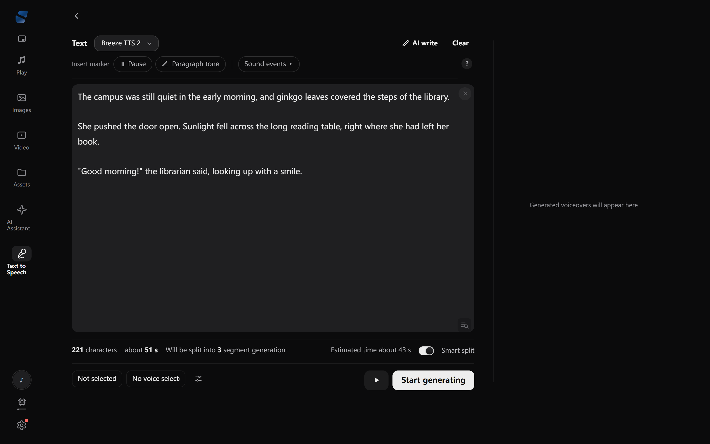
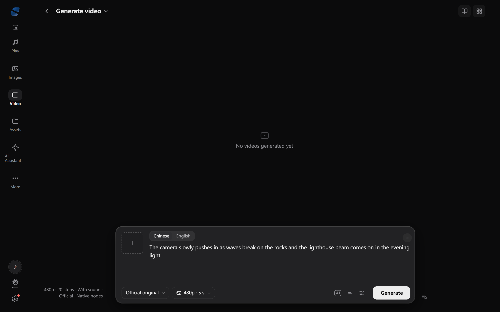
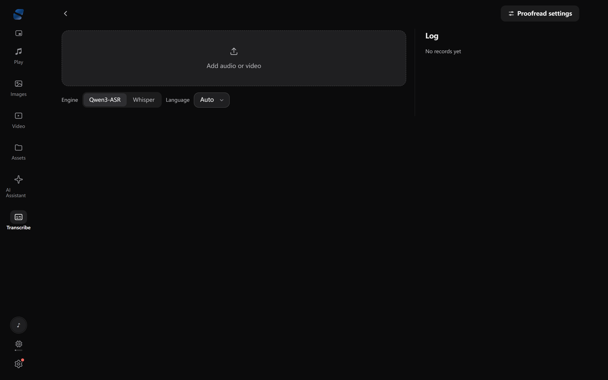
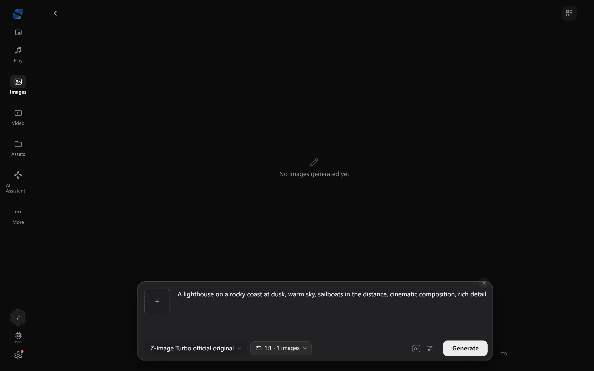

# Studio

**A local, self-hosted creative workstation for speech, image and video generation.**

Studio brings text-to-speech, voice conversion, transcription, image generation, and video generation and editing together in one application that runs entirely on a single Windows PC with an NVIDIA GPU. It also includes a media player and an asset library. A Python backend coordinates several local inference engines. A dependency-free JavaScript frontend serves the same interface to a desktop window, a browser, and a paired phone.


---

## Contents

- [Highlights](#highlights)
- [Screenshots](#screenshots)
- [Features](#features)
- [Architecture](#architecture)
- [Interface design and verification](#interface-design-and-verification)
- [Speech and language pipeline](#speech-and-language-pipeline)
- [Security and privacy](#security-and-privacy)
- [Agent interface (MCP)](#agent-interface-mcp)
- [Getting started](#getting-started)
- [Testing](#testing)
- [Repository layout](#repository-layout)
- [Acknowledgements](#acknowledgements)

---

## Highlights

- **One application, many local models.** The backend schedules four GPU engines on one card: an audio engine for speech, an image engine, a video engine and a local LLM. It queues work across them, frees memory between jobs, and restarts an engine automatically if it fails.
- **A single interface for desktop and phone.** The same vanilla-JavaScript frontend runs in a desktop window (pywebview), a browser, and an installable phone web app. On the phone it uses touch-first layouts: bottom sheets, pull-to-dismiss, and controls sized for one-tap use.
- **Interface quality is verified automatically.** A Playwright-based audit harness loads every page at 24 viewport sizes, simulates real clicks and touch gestures, and checks layout, overflow, touch-target size and hit-testing rules. It also captures screenshots for review (see [Interface design and verification](#interface-design-and-verification)).
- **A complete speech workflow.** It covers script-to-speech with voice cloning and per-paragraph direction, voice conversion, speech recognition with LLM proofreading, synchronized lyrics and subtitles, and text-instructed editing of recorded speech.
- **Secure remote access.** Phones pair with a one-time code over a private Tailscale network. A WebAuthn passkey (Face ID / Touch ID) unlocks the private space, and push notifications carry no content.
- **Agent-ready.** A Model Context Protocol (MCP) server lets coding agents such as Claude Code drive batch work through opaque identifiers, without ever seeing file names or media.
- **English and Chinese interface.** English is the default. Change the language under *Settings → Appearance → Language*.

## Screenshots

| | |
|---|---|
|  |  |
| **Player:** library, folders and a queue for local audio and video | **Text to speech:** script editor with automatic segmentation and direction |
|  |  |
| **Video:** generation from a first frame, reference media and a prompt | **AI Assistant:** local-LLM prompt writing with editable presets |
|  |  |
| **Transcribe:** Qwen3-ASR or Whisper, then proofreading by an LLM | **Settings:** appearance, language, playback, phone access and storage |
|  |  |
| **Edit video:** character swap, face swap, outfit change and motion transfer | **Image composer:** prompt, model, size and advanced settings in one bar |

<p align="center">
  
  &nbsp;&nbsp;
  
</p>
<p align="center"><em>The same interface as a home-screen web app on iPhone.</em></p>

> The screenshots show a clean test installation with generated test data. The voice engine is not bundled with the repository, so its model list in the screenshots is populated from the project's own `server.json`.

## Features

### Speech
- **Text to speech.** Paste a script, choose or design a voice, and optionally add direction (emotion, delivery and pauses) per paragraph. Long scripts are split into segments automatically, and any single segment can be regenerated on its own. Models run through [audio.cpp](https://github.com/), with profiles for Breeze TTS 2, IndexTTS-2.5 and Qwen3-TTS, plus specifications for more than a hundred other audio model families.
- **Voices.** Design a voice from a description, clone one from an uploaded clip, or record one live.
- **Voice changer.** Convert a recording to another voice (Seed-VC / RVC).
- **Transcribe.** Speech-to-text with Qwen3-ASR or Faster-Whisper, followed by optional proofreading with an LLM (Anthropic Claude, any OpenAI-compatible endpoint, or a local model).
- **Edit recording.** Change, insert or delete words in a recording from a one-line instruction while keeping the original voice and tone (Tencent AuK).
- **Subtitles and translation.** Time-synchronized lyrics and subtitles in the player, translated with Google Translate or offline with Index-Translate-9B.

### Images
- Text to image, image to image, inpainting and instruction-based editing with Qwen-Image 2.1, MOSS Image, Krea 2, MiniMax H3-Image and Z-Image Turbo. The models run in ComfyUI or stable-diffusion.cpp.
- **Prompt enhancement.** Uses the official prompt-enhancement models, or the local AI Assistant writes the prompt from the image and the request.
- **Editable advanced settings.** Recommended defaults are shown, and steps, CFG, sampler, scheduler and resolution can all be changed. Automatic face and hand refinement, color correction, and a side-by-side compare view are included.
- **Assets.** A library of poses, outfits, faces and folders feeds directly into prompts and reference images.

### Video
- Generation with the official MiniMax H3 models through ComfyUI. Inputs can be first and last frames, reference images, video or audio, and a structured prompt. Optional acceleration LoRAs, upscaling (SeedVR2) and frame interpolation (RIFE) are available.
- **Video editing.** Character swap, face swap (face-swap LoRA), outfit change and motion transfer. A selected segment can be spliced back into the source, and source color can be matched automatically.
- **Suggested segments.** Cut points are detected from beats, accents and motion (with optional music-structure analysis). A small on-device model then learns from the user's own segment choices. It is a logistic-regression ranker validated with leave-one-out, and it is used only when it beats the hand-written rules.
- **Batch recipes.** Run a whole set of videos through one saved recipe: segment, generate, check quality, retry with a new seed, pick the best attempt and splice it back. Progress survives a restart.
- **Automatic quality checks** run on the CPU: they verify the subject is present, the face stays consistent, motion matches the source, and brightness doesn't drift.

### Player and library
- A music- and video-player page with folders, a queue, favorites, synchronized lyrics, picture-in-picture, and full-screen "now playing" views on desktop and phone.
- Frame capture from any enlarged video into albums in the asset library.

## Architecture

```
            Desktop window (pywebview)  ·  Browser  ·  iPhone home-screen web app
                                         │  HTTP / JSON, static files (gzip + ETag)
                                         ▼
 ┌──────────────────────────── studio/server.py  (port 7860) ─────────────────────────────┐
 │ routing · job queues · GPU lock & VRAM release · private space · pairing · push        │
 │ modules: imagegen / q21 (images) · videogen / videoedit (video) · stt · translate      │
 │          audioedit · batch · segpref · frames · agentapi · passkey · remote · push    │
 └──────┬───────────────────┬────────────────────┬────────────────────┬──────────────────┘
        ▼                   ▼                    ▼                    ▼
   audio.cpp server     ComfyUI (8188)    stable-diffusion.cpp   llama.cpp
   TTS · ASR · VC       image & video     image engine           prompt assistant,
   (port 8080)          workflows built                          translation
                        in code (API format)
```

- **Backend.** Plain Python standard library (a threaded `http.server`), with no web framework. Each feature lives in its own module. GPU work is serialized through a shared lock, so one engine releases VRAM before another loads. Idle engines shut down after a timeout. Long-running jobs persist to disk and resume after a restart.
- **Frontend.** Native JavaScript and CSS with no build step (`studio/web`). Hover and touch behavior is separated (`touch.js`) so that every control acts on a single tap. A responsive layer (`phone.css` / `phone.js`) adapts the interface to phones.
- **Workflows.** ComfyUI graphs are assembled in code from the official templates. Placeholders (seed, steps, LoRAs, sizes) are filled per job, and every job records exactly what it ran.
- **Desktop app.** `studio/app.py` wraps the interface in a native window (pywebview, Edge WebView2). It adds a floating mini player and taskbar integration.

## Interface design and verification

The interface is treated as a product: it follows written design principles, and automated checks verify that the result actually meets them.

- **Design principles.** Hierarchy explains structure, so the interface avoids redundant labels. Explanations appear in hover or tap tooltips rather than as inline help text. Wording is formal. No region scrolls unless it has to. On touch devices, one tap acts. The rules draw on Apple's Human Interface Guidelines and published interface guidelines (including Vercel's web interface guidelines). They cover visual hierarchy and layout, typography and contrast, interface states, user flows, forms and errors, and accessibility.
- **Audit harness** (`devtest/ui-audit/`). Playwright drives an isolated test instance of Studio:
  - Every page is checked at 24 viewport sizes, from phone widths to 3840 px desktops. The checks also cover landscape, tablet and light theme.
  - Navigation uses real clicks rather than programmatic routing. On the phone, real touch sequences exercise swipes, pull-to-dismiss and long-press.
  - Rule checks flag horizontal overflow, unnecessary scrolling, overlapping or clipped text, controls hidden behind fixed bars, touch targets smaller than 44 × 44 pt, empty containers, broken images, console errors and failed requests.
  - A validation suite plants each class of defect in a page on purpose. Every rule must catch its planted defect before the rule can be trusted.
  - Each defect found is marked on a screenshot, and contact sheets are produced for visual review.
- **iPhone emulation** (`devtest/ui-audit/iphone.py`). The harness reproduces safe areas, the Dynamic Island, standalone (home-screen) mode and the iOS user agent in WebKit. It is used to check sheet gestures, keyboard behavior and the now-playing views.
- **Regression flows.** Scripted end-to-end flows exercise the image page (model switching, inpainting canvas binding, settings overrides), the player, viewers and sheets after each change.

## Speech and language pipeline

- **Recognition.** Qwen3-ASR runs through the audio engine, with Faster-Whisper as an alternative. Transcripts can be proofread by an LLM. The provider is configurable: Anthropic Claude via the official API (`claude-opus-5-5` by default), an OpenAI-compatible endpoint, or a fully offline local model.
- **Synthesis.** Scripts are segmented with sentence-aware rules and rendered per segment, then merged atomically. A failed export never leaves a half-written result. Every segment can be redone without regenerating the rest.
- **Real-time playback.** The player streams audio with Web Audio and keeps lyrics in sync. A remote-control channel lets the desktop control playback on a phone, and the phone keeps running while the screen is locked.
- **Local LLM services.** llama.cpp runs a local prompt assistant and an offline translation model. Both start on demand and exit when idle to release GPU memory.

## Security and privacy

- **Phone access.** Studio listens on the Tailscale interface only, never on the local Wi-Fi. A phone pairs with a six-digit code that expires after five minutes and is voided after five wrong attempts. The phone then keeps a per-device token. Devices can be revoked from the desktop at any time.
- **Passkeys.** WebAuthn ES256 passkeys (Face ID / Touch ID) unlock the private space. The server stores only public keys and verifies a single-use challenge, the origin, the user-verification flag and the signature.
- **Private space.** Private-space jobs, galleries and settings live in a separate data folder, and their push notifications never include names or prompts. Remote-control playback of private items uses one-time URLs that are bound to one device.
- **Agent isolation.** The agent API returns only HMAC-derived opaque identifiers and numbers, never file names, titles or media. Messages are scrubbed of paths and names before they leave the server.

## Agent interface (MCP)

`studio/agent_mcp.py` is an MCP server built on the official Python SDK. It exposes Studio's batch workflow to coding agents through a small set of tools:
- `list_videos`
- `cutpoints` / `recommend_segments`
- `edit_outfit`
- `job_status`
- `check_quality`
- `retry`
- `list_recipes` / `run_recipe`

The MCP process holds no data of its own: it forwards calls to the running Studio (`/api/agent/*`). A private-space key can be stored locally with Windows DPAPI.

## Getting started

**Requirements:** Windows 10/11, an NVIDIA GPU (the video models need a high-VRAM card), and Python 3.13.

1. Clone the repository.
2. Install the engines you plan to use and place them next to the `studio/` folder:
   - `audio.cpp/` for speech
   - `llama.cpp/` for the prompt assistant and translation
   - `tools/ComfyUI_windows_portable/` for images and video
   - `tools/ffmpeg/` for media processing
3. Download model weights into `models/` (speech and LLM) and the ComfyUI `models/` folders (image and video). `server.json` lists the speech models the audio engine loads. Each image and video model shows the exact files it needs in the interface, and anything missing is labeled *Not downloaded*.
4. Start Studio:
   - Browser: `start-studio.bat` (opens http://127.0.0.1:7860)
   - Desktop window: `start-app.bat`

   Both scripts use `python` from `PATH`. Set `STUDIO_PYTHON` to use a different interpreter.

Model weights and engines are not included in this repository. Each model is subject to its own license.

## Testing

```powershell
# Unit tests (no server, no GPU)
cd devtest
python -m pytest tests/unit

# Isolated test instance (separate ports and data; never touches a running Studio)
python -I devtest/run.py --profile chk

# API smoke tests against the test instance
cd devtest
python -m pytest tests/api

# Interface audit (Playwright; see devtest/ui-audit/README.md)
```

`devtest/run.py` starts a fully isolated instance with its own ports, its own data folder and generated test media (`devtest/make_fixtures.py` creates tones, color bars and test patterns with FFmpeg), so tests never touch real data.

## Repository layout

| Path | Contents |
|---|---|
| `studio/server.py` | HTTP server, routing, job queues, GPU coordination |
| `studio/*.py` | Feature modules (images, video, speech, batch, agent API, security) |
| `studio/web/` | Frontend: HTML, CSS and JavaScript (no build step), `i18n.js` language layer |
| `studio/specs/`, `studio/profiles/` | Audio model specifications and per-family profiles |
| `studio/workflows/` | ComfyUI workflow templates |
| `devtest/` | Test launcher, unit and API tests, interface audit harness, tools |
| `scripts/` | Uninstall script |

## Acknowledgements

Studio builds on the work of many open-source projects and model authors, including:
- audio.cpp, llama.cpp, stable-diffusion.cpp and ComfyUI
- Qwen (Qwen-Image 2.1, Qwen3-ASR, Qwen3-TTS), MiniMax H3, MOSS, Krea, Z-Image, IndexTTS, Breeze TTS, Seed-VC, Faster-Whisper, Index-Translate, SeedVR2 and RIFE
- the Model Context Protocol Python SDK, Playwright and pywebview

See each project for its license terms.
