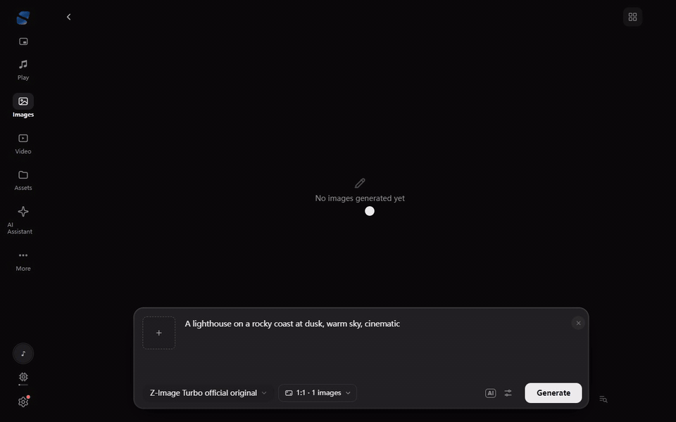
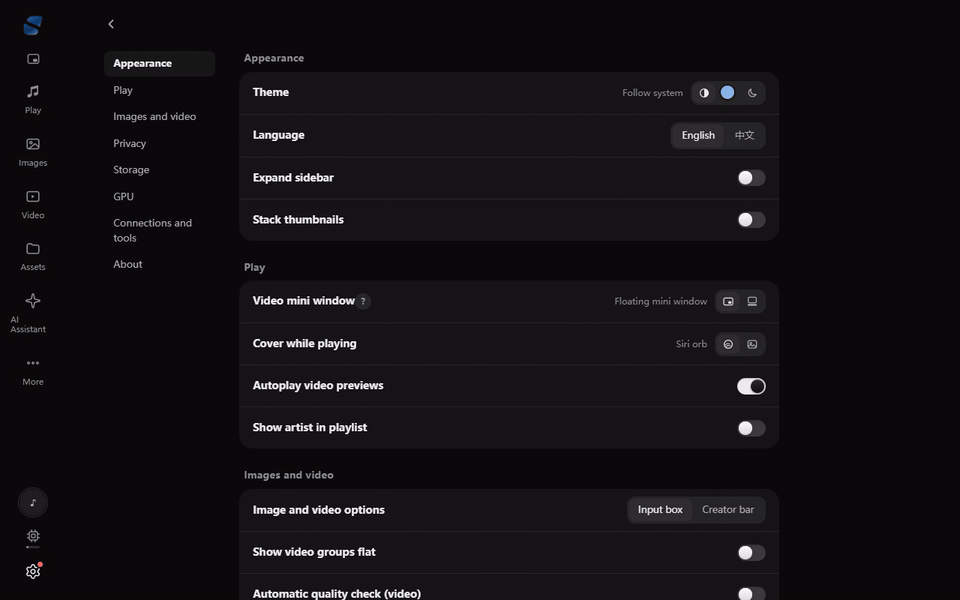
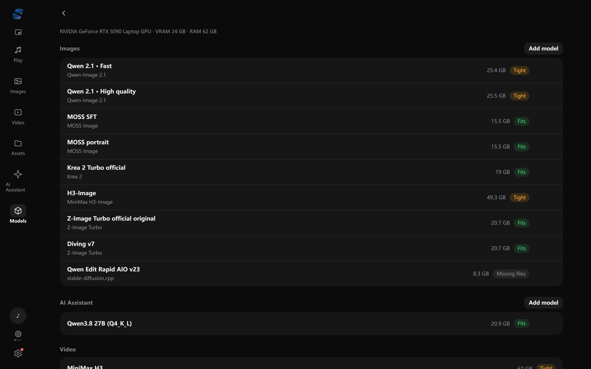
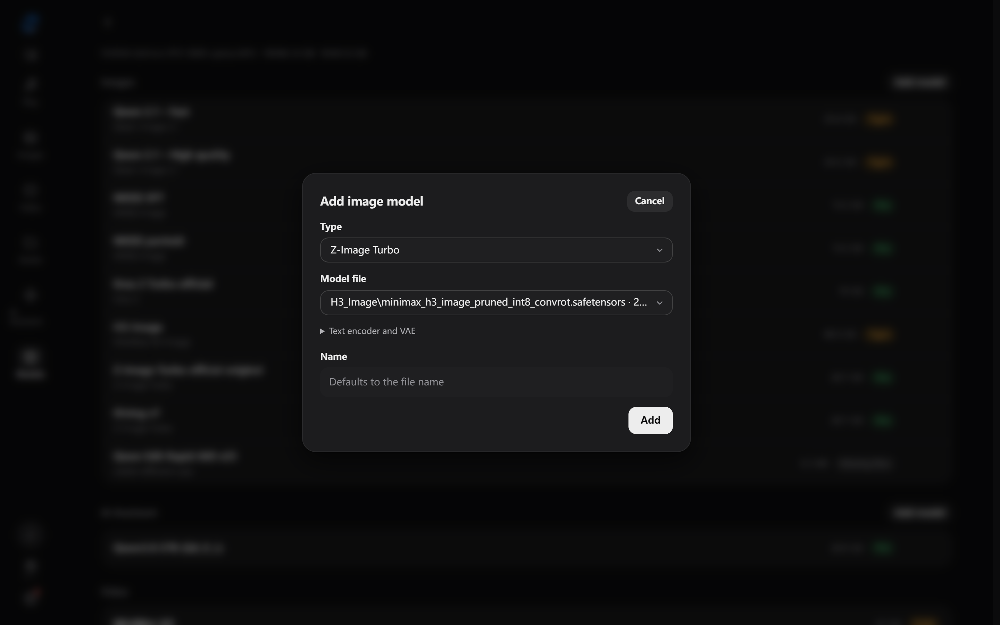
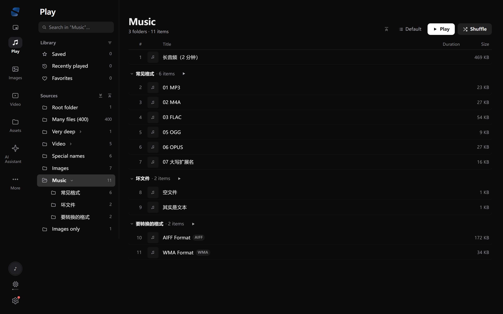
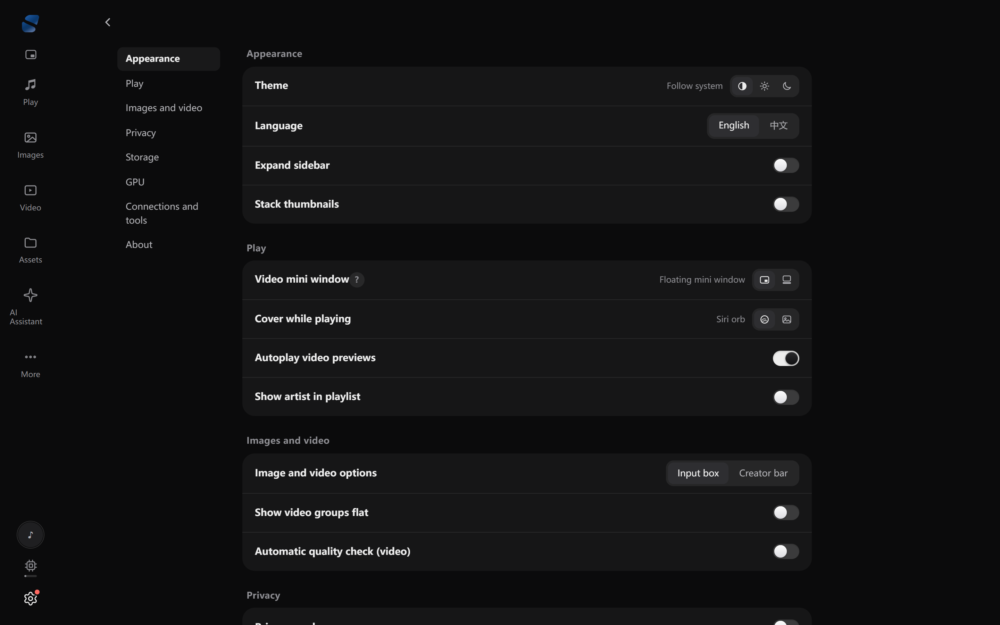
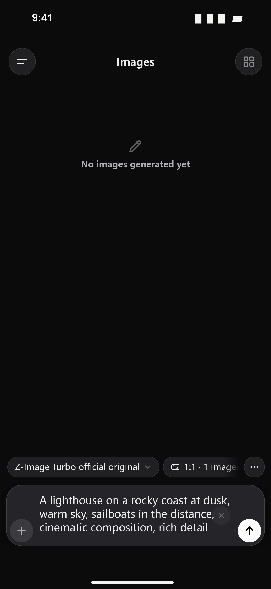

<div align="center">


# Studio

**A local, self-hosted creative workstation for speech, images and video.**


[Interface](#interface) · [Speech](#speech-and-language) · [Images and video](#images-and-video) · [Models](#your-models-your-hardware) · [More features](#more-features) · [Getting started](#getting-started) · [Engineering](#engineering)


</div>

Studio runs text-to-speech, voice conversion, transcription, image generation and video editing on one local Windows PC with an NVIDIA GPU. A Python backend schedules several inference engines on that one GPU. A dependency-free JavaScript frontend serves the same interface to a desktop window, a browser and a phone.

- **One interface everywhere.** Desktop window, browser and iPhone, in two layouts, light or dark, English or Chinese. Interface changes are tested automatically at 24 screen sizes.
- **A complete speech pipeline.** Speech recognition, LLM proofreading, text-to-speech with voice cloning and per-paragraph direction, voice conversion, and synchronized playback.
- **Private by design.** Everything runs locally. Phones pair over a private network, and passkeys unlock the private space. Coding agents can work through an MCP interface without ever seeing file names or media.

---

## Interface

One interface adapts to how and where you work.

<table>
  <tr>
    <td width="50%"></td>
    <td width="50%"></td>
  </tr>
  <tr>
    <td><b>Two layouts.</b> Generation options can live in a bottom input box, or in a creator bar down the left side.</td>
    <td><b>Light and dark.</b> Follows the system or set manually; the browser chrome color follows the page.</td>
  </tr>
  <tr>
    <td></td>
    <td align="center"></td>
  </tr>
  <tr>
    <td><b>English and 中文.</b> A runtime layer translates the UI in place, and text you type is never altered.</td>
    <td><b>Touch-first on iPhone.</b> One tap acts, options open next to their control, and sheets close with a pull-down.</td>
  </tr>
</table>

<details>
<summary><b>Design principles and interface testing</b></summary>
<br>

**Principles.** These draw on Apple's Human Interface Guidelines and published web interface guidelines, and cover visual hierarchy, layout, typography, color and contrast, interface states, user flows, forms and errors, and accessibility. In practice:
- Hierarchy explains structure, so there are no redundant labels.
- Explanations go in tooltips, not inline help text.
- Wording is formal.
- Nothing scrolls unless it has to.
- On touch devices, one tap acts.

**Audit harness** (`devtest/ui-audit/`). Playwright drives an isolated test instance:
- **Coverage:** every page is checked at 24 viewport sizes, from phones to 3840 px wide, plus landscape, tablet and the light theme.
- **Real interaction:** navigation uses real clicks. On phones, real touch sequences exercise swipes, pull-to-dismiss and long-press.
- **Rules:** horizontal overflow, unnecessary scrolling, overlapping or clipped text, controls hidden behind fixed bars, touch targets under 44 × 44 pt, empty containers, broken images, console errors and failed requests.
- **Validated rules:** a validation suite plants each type of defect in a page, and a rule counts only once it catches its planted defect.
- **Review:** findings are marked on screenshots and collected into contact sheets.

**iPhone emulation** (`devtest/ui-audit/iphone.py`) runs WebKit with the safe areas, the Dynamic Island, standalone mode and the iOS user agent. It is used to test sheet gestures, keyboard behavior and the now-playing views.

**Regression flows.** Scripted end-to-end flows exercise the image page (model switching, inpainting canvas binding, settings overrides), the player, viewers and sheets.

</details>

## Speech and language


- **Text to speech.** Write a script and choose a voice. You can add direction per paragraph: emotion, delivery, pauses and sound events. Long scripts are split into segments and rendered one by one. Any segment can be redone on its own, and the final merge is atomic.
- **Voices.** Design a voice from a description, clone one from a short clip, or record one live. Profiles cover Breeze TTS 2, IndexTTS-2.5 and Qwen3-TTS, and the audio engine supports more than a hundred model families.
- **Transcription.** Uses Qwen3-ASR or Faster-Whisper. An LLM can then proofread the transcript. The LLM is configurable: Anthropic Claude through the official API, any OpenAI-compatible endpoint, or a fully offline local model.
- **Voice changer** (Seed-VC / RVC). **Edit recording:** change, insert or remove words from a one-line instruction while keeping the speaker's voice.
- **Playback.** Web Audio playback with time-synchronized lyrics and subtitles, which can be translated online or offline. The desktop can control playback on a phone, and the phone keeps playing with its screen locked.
- **AI Assistant.** A local LLM, run by llama.cpp, chats and writes prompts using editable presets. It loads on demand and unloads when idle to free GPU memory.

## Images and video

<table>
  <tr>
    <td width="50%"></td>
    <td width="50%"></td>
  </tr>
</table>

- **Images.** Text to image, image to image, inpainting and instruction-based editing with Qwen-Image 2.1, MOSS Image, Krea 2, MiniMax H3-Image and Z-Image Turbo, run through ComfyUI or stable-diffusion.cpp. Recommended settings are filled in, but every value can be edited. Also included: prompt enhancement, face and hand refinement, color correction and a compare view.
- **Video.** Generation with the official MiniMax H3 models from first and last frames, reference media and a structured prompt. Editing covers character swap, face swap, outfit change and motion transfer. An edited segment can be spliced back into the source with matched colors.
- **Suggested segments.** Cut points are detected from beats, accents and motion. A small on-device ranker then learns from your choices. It is a logistic regression validated with leave-one-out, and it is used only when it beats the hand-written rules.
- **Batch recipes.** One saved recipe can process many videos. Each segment is generated and checked for quality on the CPU. A segment that fails is retried with a new seed, the best attempt is kept and spliced back, and progress survives a restart.

## Your models, your hardware

<table>
  <tr>
    <td width="50%"></td>
    <td width="50%"></td>
  </tr>
</table>

- **Hardware-aware.** The *Models* page detects the GPU and system memory and estimates whether each model fits: entirely in VRAM, partly offloaded to RAM (slower), or not at all.
- **Bring your own models.** To add a model, pick a model type and then a file from the matching folder. Supported types:
  - **Images:** Qwen-Image, MOSS, Krea 2, H3-Image or Z-Image fine-tunes, and any SD 1.5 / SDXL / Pony checkpoint.
  - **AI Assistant:** any GGUF chat model, fitted to VRAM automatically with llama.cpp `--fit`.
  - **Speech:** more than ninety audio.cpp model families.
  - Built-in models can be hidden, and additions are saved to `studio/user-models.json`.
- **Data, not code.** Built-in models live in `studio/catalog/*.json` (files, recommended settings, descriptions), so new entries need no code changes.
- **Configurable paths.** Models, ComfyUI, ffmpeg, llama.cpp and audio.cpp can live anywhere. Point to them with environment variables (`STUDIO_MODELS_DIR`, `STUDIO_COMFY_DIR`, …) or the `paths` section of `studio/settings.json`; see `studio/config.py`.

## More features

<details>
<summary><b>Player, assets, phone access, agents and more</b></summary>
<br>

- **Player.** Library, folders, queue, favorites, synchronized lyrics, picture-in-picture, and full-screen now-playing views.
- **Assets.** Poses, outfits, faces and folders feed straight into prompts and reference images. Frames captured from any enlarged video are saved as albums.
- **Desktop app.** A native window (pywebview, Edge WebView2) with a floating mini player and taskbar integration.
- **Phone access.** An installable home-screen web app over Tailscale, with pairing codes, passkeys and push notifications that carry no content.
- **Private space.** A separate space with its own data folder, galleries and settings, unlocked with a key or Face ID.
- **Agent interface (MCP).** Coding agents such as Claude Code can list videos, find cut points, start jobs, check quality and run batch recipes. They only ever see opaque identifiers.
- **Prompt inspector.** Shows the exact prompt and template every job sent to the model. Templates are editable as named sets.

</details>

<details>
<summary><b>More screenshots</b></summary>
<br>

| | |
|---|---|
|  |  |
| **Player:** library, folders and queue | **AI Assistant:** local-LLM prompt writing with presets |
|  |  |
| **Video generation:** first frame, references and a structured prompt | **Transcribe:** Qwen3-ASR or Whisper, then LLM proofreading |
|  |  |
| **Settings:** appearance, language, playback, phone access and storage | **Image composer:** prompt, model, size and advanced settings in one bar |

<p align="center">
  
  &nbsp;
  
</p>

</details>

## Getting started

**Requirements:** Windows 10 or 11, an NVIDIA GPU (the video models need a lot of VRAM), and Python 3.13.

1. Clone the repository.
2. Put the engines you need next to `studio/`:
   - `audio.cpp/` for speech
   - `llama.cpp/` for the assistant and translation
   - `tools/ComfyUI_windows_portable/` for images and video
   - `tools/ffmpeg/` for media handling
3. Download model weights, or reuse files you already have:
   - Speech models go in `models/`. `server.json` lists the built-in ones.
   - Image and video models go in the ComfyUI `models/` folders.
   - Open **More → Models** to see which files are missing, whether each model fits your GPU, and to add your own.
   - To keep models on another drive, set `STUDIO_MODELS_DIR` (and `STUDIO_COMFY_DIR` for ComfyUI).
4. Start Studio:
   - Browser: `start-studio.bat`, which opens http://127.0.0.1:7860
   - Desktop window: `start-app.bat`
   - Both use `python` from `PATH`. Set `STUDIO_PYTHON` to use a different interpreter.

Model weights and engines are not included in this repository. Each model has its own license.

## Engineering

<details>
<summary><b>Architecture</b></summary>
<br>

```
            Desktop window (pywebview)  ·  Browser  ·  iPhone home-screen web app
                                         │  HTTP / JSON, static files (gzip + ETag)
                                         ▼
 ┌──────────────────────────── studio/server.py  (port 7860) ─────────────────────────────┐
 │ routing · job queues · GPU lock & VRAM release · private space · pairing · push        │
 │ modules: imagegen / q21 (images) · videogen / videoedit (video) · stt · translate      │
 │          audioedit · batch · segpref · frames · agentapi · passkey · remote · push    │
 └──────┬───────────────────┬────────────────────┬────────────────────┬──────────────────┘
        ▼                   ▼                    ▼                    ▼
   audio.cpp server     ComfyUI (8188)    stable-diffusion.cpp   llama.cpp
   TTS · ASR · VC       image & video     image engine           prompt assistant,
   (port 8080)          workflows built                          translation
                        in code (API format)
```

- **Backend.** Built on the Python standard library: a threaded `http.server`, no web framework, with each feature in its own module.
  - GPU work goes through one shared lock, so an engine releases VRAM before the next one loads.
  - Idle engines shut down after a timeout, and a crashed engine restarts automatically.
  - Long jobs are saved to disk and resume after a restart.
- **Frontend.** Native JavaScript and CSS with no build step. `touch.js` separates hover from touch, and `phone.css` / `phone.js` adapt the layout for phones. `i18n.js` translates the interface at runtime.
- **Workflows.** ComfyUI graphs are assembled in code from the official templates. Placeholders such as seed, steps, LoRAs and size are filled in per job, and every job records exactly what it ran.

</details>

<details>
<summary><b>Security and privacy</b></summary>
<br>

- **Phone access.** Studio listens only on the Tailscale interface, never on local Wi-Fi.
  - Pairing uses a six-digit code that expires after five minutes and is voided after five wrong attempts.
  - Each paired phone gets its own device token, and any device can be revoked.
- **Passkeys.** WebAuthn ES256 passkeys (Face ID / Touch ID) unlock the private space. The server stores only public keys and checks a single-use challenge, the origin, the user-verification flag and the signature.
- **Private space.** It keeps a separate data folder. Its notifications carry no names or prompts, and remote playback of private items uses one-time URLs bound to one device.
- **Agent isolation.** The agent API returns only HMAC-derived opaque identifiers and numbers. Messages are scrubbed of paths and names before they leave the server.

</details>

<details>
<summary><b>Testing</b></summary>
<br>

```powershell
cd devtest
python -m pytest tests/unit                    # unit tests: no server, no GPU
python -I run.py --profile chk                 # isolated test instance: own ports, own data, generated test media
python -m pytest tests/api                     # API smoke tests against the test instance
```

`devtest/make_fixtures.py` generates the test media (tones, color bars and test patterns) with FFmpeg, so tests never touch real data. The interface audit is documented in `devtest/ui-audit/README.md`. All screenshots and animations in this README were recorded from a test instance using generated test data. The speech engine is not bundled, so the voice-model list shown comes from `server.json`.

</details>

<details>
<summary><b>Repository layout</b></summary>
<br>

| Path | Contents |
|---|---|
| `studio/server.py` | HTTP server, routing, job queues, GPU coordination |
| `studio/*.py` | Feature modules: images, video, speech, batch, agent API, security |
| `studio/web/` | Frontend (HTML, CSS, JavaScript; no build step) and the `i18n.js` language layer |
| `studio/specs/`, `studio/profiles/` | Audio model specifications and per-family profiles |
| `studio/catalog/` | Built-in model catalog (image, AI Assistant); your own additions go in `studio/user-models.json` |
| `studio/config.py` | Where models, engines and tools are found (environment variables / `settings.json`) |
| `studio/workflows/` | ComfyUI workflow templates |
| `devtest/` | Test launcher, unit and API tests, interface audit harness, tools |
| `scripts/` | Uninstall script |

</details>

<details>
<summary><b>Acknowledgements</b></summary>
<br>

Studio builds on many open-source projects and model authors:
- **Engines:** audio.cpp, llama.cpp, stable-diffusion.cpp and ComfyUI.
- **Models:** Qwen (Qwen-Image 2.1, Qwen3-ASR, Qwen3-TTS), MiniMax H3, MOSS, Krea, Z-Image, IndexTTS, Breeze TTS, Seed-VC, Faster-Whisper, Index-Translate, SeedVR2 and RIFE.
- **Libraries:** the Model Context Protocol Python SDK, Playwright and pywebview.

See each project for its license terms.

</details>
